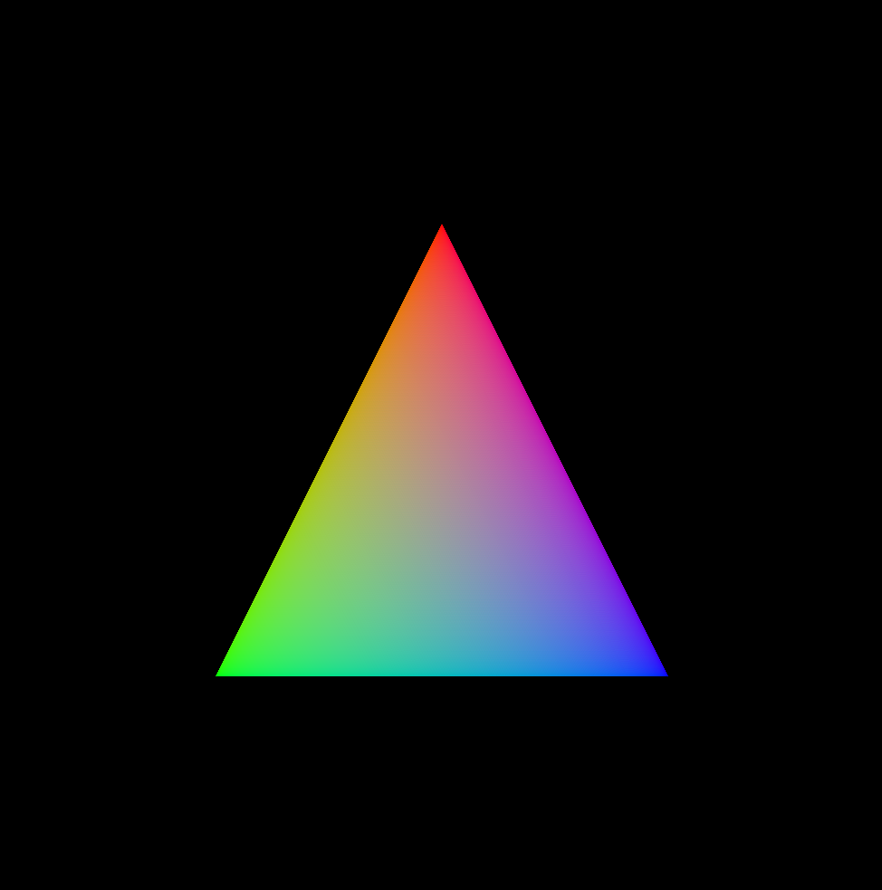

# wgpu-conduit

A mostly unopinionated wrapper over wgpu for real-time applications driven by the main thread.

### Features
- Supports both windowed and headless modes through decoupled `Canvas` and `GpuContext` types
- Easily configure gpu resources using typestate builders called `blueprints`.
- All gpu resources are created on worker threads using the `tokio` runtime. 
- Gpu resources are tracked via lightweight, copyable ids.
- Automatic and configurable TTL expiring for gpu resources that are no longer used.
- Execution system only submits gpu commands so long as resource dependencies are ready.
- Mapping between wgpu primitives and blueprints is mostly one-to-one.

### Limitations
- Requires `winit` even if only used in headless mode (for now).
- Is not `no-std`.
- Requires a `tokio` runtime.

## How to Use - Setup
At the heart of `wgpu-conduit` is the `GpuContext`. This is used to track resources using an id system. You can create a context like so:

```rust
// `init_blocking()` uses pollster to block the main thread 
// until the gpu is initialized.
//
// You can also call `init()`, which returns a future that 
// resolves with the `GpuContext`.
let context = GpuContext::builder()
    .init_blocking()
    .expect("Failed to initialize gpu context");
```

The rendering surface and window are packaged together using a `Canvas`. This will typically live alongside the `GpuContext` inside the main application handler. You can skip this step if doing headless mode.

```rust
// `init()` takes in a `winit` window and a reference to the
// `GpuContext` upon initialization. This is so it can create 
// the rendering surface the `Canvas` represents.
let canvas = Canvas::builder()
    .init(window, &context)
    .expect("Failed to initialize rendering canvas");
```
### Synchronization and Redraw Events

The `GpuContext` creates resources through background worker threads. These threads communicate with the main thread via a MPSC channel. This channel **must be synchronized regularly**, typically once per frame or update tick. 

If using windowed mode, It's recommended to do this in the application handler's `about_to_wait()` method. You would also request a `winit` redraw event with the `Canvas` here as well. Luckily, this is very simple to do: 

```rust
context.sync()
canvas.request_redraw()
```
That's it! Once you ensure you're calling `sync()` regularly, using the rest of the api is very straightforward.

### TLL and Hold Policies

All resources are configured with a `HoldPolicy`, which determines how long the resources stay alive for (Also known as TTL, or time-to-live). The `GpuContext` can be configured with a `GlobalHoldPolicy`, which is `Indefinite` by default for all resources. `Indefinite` just means the resource never expires. The global policy for any specific resource can be overridden with it's blueprint.

Hold policies only take effect once the resource is ready to use at the next call to `sync()`.

## Drawing a Triangle
The "Hello, World" of graphics programming is widely considered to be drawing a triangle. So it's fitting that this would be the example for using `wgpu_conduit` in windowed mode. First, we need to create the gpu resources. Doing so is very straightforward.

### Creating Gpu Resources
Once the `GpuContext` is created, you can request gpu resources through it by calling it's `request_*()` methods. These methods immediately return lightweight, copyable ids that can be used elsewhere, but otherwise spawn worker threads to create the actual gpu resource.

For the vertex buffer of our triangle, we also need a layout. That can be done by implementing the `VertexLayout` trait. It's recommended to implement it on the C-style struct your vertex data will live in.

```rust
/// A vertex with a position and color attribute
#[repr(C)]
#[derive(Debug, Copy, Clone, bytemuck::Pod, bytemuck::Zeroable)]
pub struct Vertex {
    position: [f32; 3],
    color: [f32; 3],
}

impl VertexLayout for Vertex {
    fn into_layout() -> VertexBufferLayout {
        // The starting location for the vertex attributes.
        let start_loc = 0;

        // This is a wrapper over a `wgpu::VertexBufferLayout`. 
        // Locations are assigned in the order the attributes
        // are added.
        VertexBufferLayout::as_vertex_step(start_loc)
            .with_attribute(wgpu::VertexFormat::Float32x3)
            .with_attribute(wgpu::VertexFormat::Float32x3)
    }
}
```

You can then request the vertex and index buffers from the `GpuContext` for the triangle like so:

```rust
// Notice how we pass in the vertex data directly. 
// This is possible because `from_vec()` accepts any Vec<T> 
// where T implements `bytemuck::POD` and `bytemuck::Zeroable`.
//
// Note that it expects an owned Vec<T> since the data will 
// later be sent to a worker thread.
let vertices = context.request_buffer(
    BufferBlueprint::vertex().with_label("triangle_vertices"), 
    BufferSource::from_vec(vec![
        Vertex { position: [ 0.0,  0.5, 0.0], color: [1.0, 0.0, 0.0] },
        Vertex { position: [-0.5, -0.5, 0.0], color: [0.0, 1.0, 0.0] },
        Vertex { position: [ 0.5, -0.5, 0.0], color: [0.0, 0.0, 1.0] },
    ])
);

// Since the T value that `from_vec()` could be anything, 
// we explicitly say that the indices are `u16`s
//
// Note that wgpu requires all buffers to be aligned to 4 bytes.
// While only 6 bytes are declared here, the index buffer is
// allocated with 8 bytes, where the last two bytes are 0s. 
// This is automatic.
let indices = context.request_buffer(
    BufferBlueprint::index().with_label("triangle_indices"), 
    BufferSource::from_vec(vec![0u16, 1, 2])
);
```

For buffers that aren't created from vectors of data, which is typical for camera uniform buffers, you can create them like so:

```rust
// Standard view-projection matrices using `glam` 
// Note that `glam` is configured with the `bytemuck` feature 
// flag in this example.
let view_matrix = glam::Mat4::IDENTITY;
let proj_matrix = glam::Mat4::perspective_rh(
    60f32.to_radians(),     // fov in radians
    16.0 / 9.0,             // aspect ratio
    0.1,                    // z-near
    100.0                   // z-far
);
let view_proj = proj_matrix * view_matrix;

// Here we create a uniform buffer prepopulated with data 
// from the view-projection matrix. `writeable()` signifies this
// buffer can be updated later, which is important for 
// camera matrices.
//
// Uniform buffers are also automatically aligned up to the 
// nearest 16 bytes as required by wgpu.
let cam_id = context.request_buffer(
    BufferBlueprint::uniform().writeable().with_label("camera-view-proj"), 
    BufferSource::from_pod(view_proj)
);

// We can then later update the buffer during the frame loop. 
// `update_buffer()` returns an error if the update would 
// overflow the buffer.
let _ = context.update_buffer(&cam_id, StructuredUpdate {
    data: &view_proj,
    offset: 0,
})
```

We can then create a `wgpu::BindGroup` with the camera's view-projection matrix like so:

```rust
// `cam_bg` holds two ids: one for the `wgpu::BindGroup` 
// and another for the `wgpu::BindGroupLayout`. This allows the
// layout id to be used in pipelines separately from the 
// bind group id.
//
// It's also worth noting that the layout ids are 
// content-addressable, so only one `wgpu::BindGroupLayout` 
// will be created for identical bind group configurations.
//
// Binding locations are assigned in the order the entries
// are added.
let cam_bg = context.request_bind_group(
    BindGroupBlueprint::new()
        .with_label("camera-bind-group")
        .with_entry(BufferBinding::uniform(cam_id))
);
```
In order to render the triangle, you also need a shader and a pipeline:

```rust
let shader_path = "triangle_shader.wgsl";
let shader_id = context.request_shader(
    // `on_disk()` will load in the shader file on the 
    // same worker thread that creates the shader.
    // You can also call `embedded()` to load in the source 
    // code at compile time.
    ShaderProgram::on_disk(shader_path).with_label("triangle-shader")
);

// Render pipelines have no color target specified by default, 
// so you need to add them yourself.
//
// This enables deferred rendering setups where you might have 
// an offscreen render pass.
//
// For on-screen render passes, you can get the surface 
// target from the `Canvas`.
//
// Notice that here is also where we set the vertex layout using 
// the `VertexLayout` trait described earlier.
let pipeline = context.request_pipeline(
    PipelineBlueprint::render(shader_id, "vs_main")
        .with_label("rendering-pipeline")
        .with_bg_layouts(&[cam_bg.layout_id])
        .with_fragment_shader(shader_id, "fs_main")
        .with_vertex_layout::<Vertex>()
        .with_color_state(canvas.surface_state(
            Some(wgpu::BlendState::REPLACE),
            wgpu::ColorWrites::ALL
        ))
);
```
### Draw Commands

Once all resources needed are created, you can record gpu commands through a stateless executor. Because it's stateless, you don't need to track any resources, and therefore recording commands can be done almost immediately. You will typically do this every frame.

However, the executor will only *submit* commands if all resources used are ready. If you're not seeing anything render, that might be the reason! Just make sure all your resources were created successfully.

It's also worth noting that resources used in a gpu command will have their hold timers reset if not set to indefinite. This ensures that if a resource is used during execution, it stays alive for the next frame.

```rust
// First acquire the next frame from the canvas. 
// This is what we use to get color attachments.
let frame = canvas.next_frame()
    .expect("Failed to acquire next canvas frame");

// Create a draw command using the frame, setting the 
// clear color to black. `standard_no_depth()` just means that
// there is only one color attachment for the surface texture
// and no depth attachment.
let mut draw_cmd = DrawCommand::standard_no_depth(
    &frame, 
    Some(wgpu::Color::BLACK),
);

// Create a draw call with the vertex, index, and pipeline 
// we created earlier for the triangle.
//
// `new()` takes in the pipeline as well as the number of 
// elements, which in our case is the number of indices 
// in the index buffer.
let draw = IndexedDraw::new(pipeline, 0..3)
    .with_bind_groups(&[cam_bg.id])
    .with_vertex_buffers(&[vertices])
    .with_index_buffer(indices, wgpu::IndexFormat::Uint16);

// add the draw call to the draw command
draw_cmd.add_draw(draw);

// Now we execute the draw command using an executor.
//
// Notice that it requires mutable access to a `GpuContext`. 
// This is so it can properly ensure the resources that the
// `DrawCommand` requires are ready. This is also where resources
// used in commands are marked as accessed, resetting their 
// hold time.
MultiBufferExecutor::execute_draw(draw_cmd, &mut context);

// Finally, present the frame to the rendering surface.
frame.present();
```

And now you know how to render a triangle! To see this in action, run the `triangle` example.

You should see something close to this:



## License

This project is licensed under:

- MIT license ([LICENSE-MIT](LICENSE) or http://opensource.org)